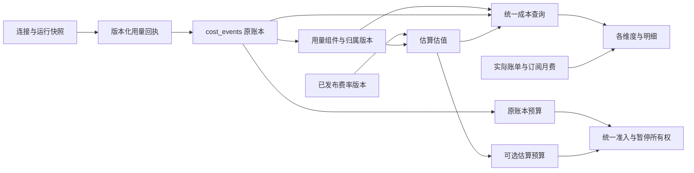

# 内部计费与用量成本模块设计

> 保存范围：仅本地 fork。2026-10-26 用户决定撤回 PR #17 并恢复 r6；完整计费模块暂不实施，先向上游提交范围协调 issue，确认维护者方向后再推进。下文对 r7 的诊断和文件落点保留为历史设计依据，不表示 r6 已有这些接口。

日期：2026-10-26。状态：待整体方案评审；业务口径 Q1–Q8 已确认，已纳入第二轮 Provider/部署通用性审查修订。本文件描述目标，不代表产品已经实现。

配套：[实施计划](2026-10-26-internal-billing-module-implementation.md)、[二次审查记录](2026-10-26-internal-billing-module-portability-review.md)。

## 1. 目标与已确认决定

这是一项跨计量、估值、归属、报表和预算的新功能。目标是让同一笔用量在公司、Provider、模型、Agent、Project、Task、User 等维度得到一致、可解释、可复现的内部成本。

| 事项 | 用户确认的规则 |
| --- | --- |
| 核算用途 | 内部成本管理，估算为主；保留账本金额、实际账单与订阅费用的独立含义 |
| Provider | 表示服务渠道。CLIProxyAPI → oMLX 归入 CLIProxyAPI，另外记录上游 oMLX，只计一次 |
| 预算 | 保留现有账本金额预算，新增可选估算成本预算；新增预算默认仅预警，明确启用后才硬停 |
| 历史价格 | 费率有版本和生效时间；调价不静默改写历史，历史重估须预览、确认和审计 |
| 历史归属 | 有运行连接证据才自动确认；缺证据留待确认，管理员预览后批量确认，原始记录保留 |
| 缺项 | 允许有明确假设的估算，展示已知金额、假设与覆盖率；未知不填 0，不标为完整 |
| 订阅 | 月费与按 token 折算的用量价值并列；第一期不分摊、不相加成总支出 |
| 币种与月界 | 估算和预算用 USD；预算继续按 UTC 自然月；外币账单按原币分列，不隐式换汇 |
| 本地模型 | 所有已确认由 oMLX 执行的模型，统一按 GPT-6 Luna 基准费率折算；新模型同样继承 |

以下是本方案确定的工程默认值，供整体评审，不再拆成新的业务问卷：费率手工发布；新报表采用半开时间区间；历史归属与估值采用版本化发布；硬停估算预算遇到无法估值的用量默认阻止新准入并保留占额；无证据的历史不强行补齐。

范围不包括对外充值/扣费、开票、支付、硬件电费、税务核算、订阅自动摊销、实时汇率和对第三方价格网页的自动抓取。

### 1.1 通用契约、公司政策和部署方式分层

| 层次 | 必须遵守的边界 |
| --- | --- |
| 产品通用核心 | 只依赖规范化计量、稳定身份、已发布政策、会计事务和权限；不识别特定公司、用户名、主机、端口、模型别名或 Provider 名称来决定收费 |
| V1 产品能力 | USD 估值、UTC 预算月、token 费率与有来源的 USD recorded_amount；这是明确能力范围，不声称支持所有厂商所有收费项目 |
| 当前公司的政策 | oMLX → Luna、CLIProxyAPI 渠道映射、现有别名/公开费率为管理员确认的配置清单；只应用到明确 companyId，其他公司和新安装不自动继承 |
| 部署集成 | PGlite 或 PostgreSQL、执行器本地或远程、回执落盘/重放由适配层负责；正常收费不访问操作者 HOME、Keychain、本机模型服务或特定部署目录 |

新安装默认没有用户私有费率或强制 benchmark；缺配置显示待估。公开价预设是可选版本数据，不是引擎内的厂商分支。新增 Provider 在自己的 adapter 中规范化即可，公共计费域和查询层不因厂商名改变。两家公司即使同名渠道/模型，也不能共享未授权的映射、假设或费率版本。

USD/UTC 的范围维持已确认决定；本次通用性修订不引入多币种换算、任意时区预算、新执行协议或全厂商计费引擎。

## 2. 当前机制与问题根因

依据：2026-10-26 对当前 r7 源码、已有账本和只读运行证据的核查。结构图索引来自 2026-10-24，涉及已变化或未索引代码时已直接读取当前源码；索引状态不作为功能正确性的证明。

1. `cost_events` 是现有用量及账本金额的事实入口。`cost_cents` 是当前有效账本金额，可能来自供应商回执、既有有限估价或对账调整；不能一概称为“真实发票金额”。`reported_cost_cents`、回执指纹和调整记录保留来源。
2. r7 的 `model_reference_rates` 只按旧 provider/model 精确匹配，在 Costs → Providers 单独计算参考价值。其他 Costs 分组、Dashboard、公司月费用、Agent/Task 等仍读原账本金额，因此账本为 0 时仍显示 0。
3. 当前 `AiProvider` 主要承担协议/鉴权兼容含义。OpenAI compatible 和 Anthropic Messages 并不能证明供应商是 OpenAI 或 Anthropic。CLIProxyAPI 没有独立渠道快照，部分旧路径还用执行器或环境变量推断 biller、subscription。
4. 部分适配器把缓存写入合并到 input 后丢掉写入子项；服务调用与 Agent 路径的 input 口径并不完全相同。原账本没有独立 cache-write 量。
5. 重试累计用量可能带最后一次尝试的 provider/model。检查点、最终回执、分模型账本同时累加会重复；从累计快照差值反推请求事实也不可靠。
6. 当前预算按账本金额、运行中金额及预留额执行；同一运行的预留与已观察金额取较大值。缺价、未收齐回执等也会影响准入。把 `cost_cents` 改成参考价会改变既有硬停行为。
7. `finance_events` 已承担发票、充值、平台费等财务事件。订阅报表展示当前标准化月费，并不等于所选历史区间的已付款金额。Browser Use 等可能同时关联 cost/finance，不能相加两次。

所以必须贯通采集和所有消费端，并保留原账本、原预算的契约。旧 Providers 价目表在新模块上线后转为兼容入口，不再单独算出第二份数字。

## 3. 核心模型：一份用量事实，多种有来源的金额

- 继续使用 `cost_events.id` 标识既有用量入账单元，不再造一套可重复记账的请求账本。
- 为一个事件附加可版本化的用量组件和估值。组件只能从属于一个事件；估值、重估和归属修正均不新增用量事件。
- 新请求尽量捕获 attempt/turn/model/route 的真实组件；旧聚合记录无法拆解时保留一个聚合组件，显示“混合或待确认”，不能把全部用量归给最后一次模型。
- `heartbeat_runs.usage_json` 保留运行诊断和实时状态，不再由页面各自重算正式费用。
- 财务凭证、订阅账户、用量估值有独立视图。账本费用可参与原预算；实际已付款只有来源明确的财务记录才能声称。

### 3.1 金额口径

| 字段/展示 | 含义与约束 |
| --- | --- |
| `basis=estimated` / 估算成本 | 使用已记录费率版本计算的用量价值，默认主报表口径；订阅包含量和本地模型也可有价值 |
| `basis=ledger` / 账本金额 | 原 `cost_cents` 及有效调整的语义，继续服务原预算；不承诺均已付款或已核对 |
| 已核对实际账单 | 发票/供应商对账的独立明细，保留原币、来源和匹配关系 |
| 订阅月费 | 当前账户月费标准或有证据的历史价格；不冒充区间付款，不计入 token 估算总计 |
| `knownSubtotalCentsExact` | 计量与价格均有依据的金额部分，不包含假设部分 |
| `assumedSubtotalCentsExact` | 有明确计算假设的金额部分；可与已知部分组成“估算小计” |
| `estimatedSubtotalCentsExact` | 当前能估出的已知＋假设部分；只要仍有未估部分，就不是完整总额 |

未知金额为 `null`，显式免费为有来源的 `0`。总览若仍有缺项，写“已估算 $X，另有 N 项待定”，不能写完整总成本 $X。

### 3.2 Provider、上游、模型与付款方

新增独立的公司级 `BillingIdentity`，存稳定 ID、slug、显示名称、停用状态；同一身份可在不同回执扮演渠道或上游。协议和鉴权枚举保持原职责。

每个用量组件保存允许列表内的 `BillingIdentitySnapshot`：

- `serviceChannelId`、`serviceChannelNameSnapshot`；例如 CLIProxyAPI。
- `upstreamId`、`upstreamNameSnapshot`，可为空；例如 oMLX。
- `requestedModel`、可选 `deploymentId`、`resolvedModel`（无观察证据则为空）、`pricingModelId`/`modelMappingVersion`，保留原始 ID。模型键绑定渠道/部署作用域和证据版本；Azure 部署名等用户别名不能直接当成底层模型。允许版本化 alias mapping，必须限定公司、连接/部署和有效时间，不按字符串猜厂商；映射随费率政策发布版本保存并在组件固定，历史补映射走批次。配置得到的 pricingModelId 不是观察到的 resolvedModel。
- `protocolId`：有界、命名空间化的协议/操作标识；已有 responses/chat_completions/messages 可作为已知值，但不能以固定四项白名单限制计费记录。`providerDialect`、`normalizerVersion` 单独记录；Bedrock/Vertex/Azure 等托管平台身份不与线协议混成一个维度。未识别值可留存并标 unknown/unsupported，不等于免费，也不自动启用新执行协议。
- `adapterType`、必要的 runtime/harness 标识，单独描述执行器。
- 连接 ID、责任用户、订阅 ID、发生时间、归属证据类型/引用及归属版本。
- `biller`、`billingType` 保留付款含义。使用 API key 不自动证明直付公价，使用 Messages 不自动证明 Anthropic 订阅。

不得复制密钥、完整连接配置、环境变量、认证身份哈希、私有 base URL 或本机路径。停用、重命名连接不改写历史快照；删除关联时保留快照和稳定业务 ID。

连接配置增加 `billing.serviceChannelId`、可选 `billing.upstreamId`。管理界面明确配置；响应能证明实际路由时保存响应证据，冲突则标记 `disputed`，不静默覆盖。unmanaged 调用可声明经服务端验证的最小元数据；无证据归入“待确认渠道”。

CLIProxyAPI → oMLX 是当前公司的验收案例：Provider 维度只出现 CLIProxyAPI，上游维度出现 oMLX；协议可为 Messages 或 Responses，模型保留真实别名；同一事件不会再出现在 OpenAI/Anthropic 渠道。其他公司有经配置或回执确认的 Anthropic 服务渠道时正常支持，不做全局屏蔽。

通用路由定义：`serviceChannel` 是该次调用实际选择的、公司管理的服务入口；调用方切换入口时生成新组件。`upstream` 是有证据的实际推理服务方；模型发布者可另记但不能替代它。多级网关可保存有序、允许列表内的 `routeHops[]` 及逐跳证据，不能复制 URL/凭据，也不能把每一跳计成用量。网关内部 fallback 只有暴露实际计量时才拆出消耗组件；仅看到响应成功不能捏造中间重试的 token。

## 4. 计量、组件与幂等

### 4.1 统一 token 口径

新契约 `NormalizedUsageV2`：`inputTokens` 排除缓存读取、包含缓存写入；`cacheReadTokens` 独立；`cacheWriteTokens` 是 input 的子集，允许未知；`outputTokens` 包含已经计入的 reasoning，reasoning 只作可选子项。

可记录写入 TTL 子项、上下文输入长度、service tier、地区、请求发生时间及其来源。数值为非负整数，超出现有 JS 安全范围时通过十进制字符串传输；新组件表用 bigint，旧字段保持兼容边界校验，禁止溢出或截断。TTL 子项不能与总 cache-write 再相加。

新适配器在其边界转换供应商语义：OpenAI 原 input 含缓存，Claude 原 input 排除读写缓存；不能拿一个公式直接处理所有原回执。Fast Response、Decision、Prompt Injection 也必须交付同一规范化契约。

数量状态区分 `observed | derived | not_applicable | unknown | unsupported`。经对应 adapter 的能力契约证明不适用的 cache-write 可取 0；不能因为响应缺字段就取 0。shared 只定义上述中性类型、校验和纯计算；原 payload/SDK、模型字符串修补、厂商缓存语义留在对应 adapter 或 server provider owner，不在 shared 中增加 normalizeProviderUsage 厂商分支。

### 4.2 单价与公式

已知写入总量 W、读取 R、规范化 input I、output O 时：

`USD = ((I - W) × inputRate + R × readRate + Σ(Wttl × writeRateTtl) + O × outputRate) / 1,000,000`

规范化单价是每个互斥 bucket 的完整单价；若来源以基础价＋附加费表达，发布政策时显式合成总单价并保留推导，不能把附加费直接当完整写入价或再叠加基础输入。

写入没有 TTL 分项但总量已知时，可按已发布策略选一个写入档位，并标记假设。若 W 未知，不得把 I 全部称作“已知普通输入”；这部分只能按明确的简化策略估算，已知小计可保留已知读取与输出。不同厂商 TTL 名称按原证据记录，不把 Claude 的 5m/1h 映射成 OpenAI 的 30m/12h。

例：I=8,000，W=2,000，R=2,000，O=1,000；费率依次为 .10/.01/.125/.50 USD/1M，普通输入为 6,000，结果为 $0.001370000，即 0.1370000 cents。没有再次收取已缓存读取或写入的普通输入价。

- 请求级长度或时间缺失时不能用整次 run 累计量判断长上下文/分时价格；按版本策略估算并保留假设，或维持未估。
- 价格缺项只影响对应部分，已知部分仍可展示。
- 金额复用 `packages/shared/src/money.ts`：BigInt nanodollars、数据库 `numeric(24,7)` cents、JSON 十进制字符串。按组件将完整公式舍入一次，再加总；不能逐展示行四舍五入后入账，不能用浮点数作预算比较。

### 4.3 能力与覆盖边界

每个计量来源声明绑定 adapter/dialect 版本的 `BillingMeterCapabilities`：可证明的 token 子项、模态、数量包含关系、时间精度、已知额外收费项及规范化版本；未声明能力默认为 unknown，不能靠 OpenAI compatible 标签证明全部语义。第一期支持已实现语义的 token-rate 与明确 USD recorded_amount；图像/音频等若不能证明适用相同单价，不因它们也叫 token 就合并按文本价收费。

缓存 token-hour、搜索调用、工具使用、图片/音频等独立收费项，若未实现精确计量和价格，不强行塞进 cache-write/output，而记录有界的 `unsupportedMeters`/`unmodeledCharges` 与来源，报告为部分成本。不能因为三类 token 都有价格就标全部收费完整。供应商回执提供可验证的整笔 USD 使用金额时可按显式 recorded_amount 策略估值；它替代该覆盖范围的 token 估值，不能两者相加。不同覆盖范围的额外费用须有独立 charge identity 与证据。

非 USD 实际金额保留 currency/amount；没有显式支持的汇率版本时不得进入 USD 小计或预算。若完整用量有独立 USD token 估值，仍可展示该估值并把外币实际账单并列。第一期不为此实现 FX 或泛用收费公式 DSL。

### 4.4 不重复计量的规则

1. 使用与运行无关的 `ProducerRef={kind,id}`：现有 kind 包括 heartbeat_run、decision、fast_response、prompt_injection，分别引用其已持久化的来源记录。组件键由 company、producer、持久化的 logicalAttemptId 与 logicalComponentId 组成，跨控制器重启/迁移保持；source authority epoch/sequence 属于接收流和写入权威，不能加入物理消耗的逻辑键而让同一用量因换控制器重计。不能恢复稳定键时保留待核对，不重新执行模型来重建证据。`heartbeatRunId` 是可空关联，不是所有用量的必填身份；服务调用不创建虚假 heartbeat。`providerRequestId` 是证据和普通索引，不能作为全局唯一键。
2. 同一 attempt 的累计 checkpoint 替换该 attempt 的最新快照，不能累加；最终回执替换当前 attempt 的 checkpoint。
3. 不同 attempt 实际消耗应累计，包括失败尝试；前一次的模型/渠道保持自己的快照。
4. 一次运行只沿用一种原账本表示：final 聚合事件，或既有互斥分模型事件。组件从属于相应事件，不能再把父事件和子组件当两笔用量。
5. 新组件集必须覆盖一个事件的完整已知用量，组件键唯一，规范化后的 input/read/output 总量一致。校验失败保留原回执及聚合兜底，标记异常，不能丢弃用量或生成看似完整的拆分。
6. 已结算后的权威用量更正以新 receipt/usage-set revision 表达，保留原事件与旧组件；只对同一稳定组件的当前有效值做替换，估算预算按差额修正，不能把新累计值再记一遍。只有更明确的受信回执可更正；无可靠身份的额外用量先待核对。组件总量校验针对所引用的权威回执版本；原事件三列仍保留其原始入账含义，不因派生修正覆盖。实际账本金额修正仍走原审计调整机制。
7. 历史无法证明 token 语义的聚合事件标记 `unknown_semantics`；不强制将原三列伪装为 V2 精确量。
8. 已有 spool、journal、原回执指纹和 `withAccountingTransaction` 的可靠提交顺序保留。估价服务不得做公网请求。可恢复的估价故障保留待估任务，不能让可入账的原回执消失。
9. 本次设计不从 checkpoint 差值创造新事实，不对 session 累计费用、journal 全部行、run 总量和 cost_events 同时求和。

### 4.5 账本金额如何按组件展示

原账本总金额仍锚定 cost event。只有组件提供可验证的金额分配且和等于父金额，才允许把账本金额拆到多个模型/渠道。否则整笔账本金额归入“混合/未分配”桶；token 估算可以按有证据的组件拆开。禁止按 token 比例臆造实际金额分配。

组件集保存可选 `ledgerAllocations`（组件键或未分配桶、金额、证据）；它是父金额的分配关系，不是第二份金额。对账调整改变父金额后，分配失效则回到未分配桶，直到重新有证据地分配。

## 5. 费率政策、版本与 oMLX

### 5.1 匹配与发布

公司级费率政策有稳定 ID、名称、优先级；每次发布生成不可变版本，包含选择器、生效时间、币种、各 token 单价/档位、假设策略、来源、核验时间、发布者和内容哈希。

- 选择器仅支持连接 ID、渠道、上游、精确模型或 `*`，以及有证据的 region/service tier/时间档位；第一期不做任意正则表达式。
- 匹配结果区分 match/no_match/insufficient_evidence。优先级先于选择器细度，同级按更具体规则匹配；仍冲突则拒绝发布或标为冲突待估，不随机选一条。若缺失字段可能命中更高优先级政策，不能把低优先级兜底谎称确定结果；只有发布的假设策略可以选择兜底并标注。
- 同一政策的新版本按 `[effectiveFrom, 下一版本 effectiveFrom)` 选取；不修改旧版本。停用也以新生效记录表达。
- 新正常发布只对现在或未来生效。首次历史基准导入、回溯改价只能走历史批次，预览可验证范围和未知项。
- 采集到请求开始时固定费率版本；组件内若模型、渠道或档位改变则生成新组件。晚到回执使用组件发生时间及已固定版本，不能套现在的价格。
- 没有可适用历史版本时显示未估，不能声称今天公开的价格过去也成立。
- 报表和预算不访问第三方价格网页；网页仅供管理员核验、编辑、发布。

### 5.2 oMLX 统一基准

仅为当前用户明确指定的目标公司创建可选政策“oMLX 按 GPT-6 Luna 折算”，通过配置清单预览/应用，禁止数据库迁移、安装或启动时向所有公司自动注入。该政策匹配 `upstream=oMLX, model=*`，并为明确直连 oMLX 的渠道提供等价匹配；优先级高于普通渠道兜底规则。

来源类型为 `user_benchmark`，基准模型 `gpt-6-luna`，参考公开价目页和核验日期，保留“用户要求统一折算”说明。它不是 oMLX 实际报价，也不改变真实模型名称。当前记录中的 .10/.01/.50 USD/1M 输入/读取/输出，以及适用写入档位，实施发布前再次核验并版本化。

该政策启用后，目标公司以后新增 oMLX 模型不必增加别名价目项；只有证据能确认 oMLX 的组件才命中。公共引擎对 oMLX、CLIProxyAPI、Luna 名称没有特判。仅看到本地端口、模型名或当前连接配置，不足以追认全部历史上游。不能暴露路由的 CLIProxyAPI 请求保留上游未知，除非管理员有证据确认对应范围。

其他已接入模型按其公开费率建立政策，无法找到公开价时允许自定义基准或保持未知；不自动生成电费或伪造官方来源。自定义价不强制填写不存在的官方 URL，但必须填写来源类型与说明。

### 5.3 覆盖率与完整性

分别保存 `usageQuality`（完整/部分/未知）、`attributionStatus`（确认/待确认/冲突）与 `valuationStatus`（完整估算/含假设/部分估值/未估/明确为零），另记计费维度覆盖。费率覆盖率不能替代计量完整率；归属不完整也不自动等于无法估值，例如上游未知但渠道、模型和适用价格均已确定。

展示完整组件数/总组件数、含假设数、未估数、待回执数；token 覆盖率只在分母已知时提供，不能把金额覆盖率或真实成本覆盖率凭空算成百分数。公司与分组保留未知桶和无 Agent/Project/Task 的服务用量。

## 6. 最小持久化扩展

表名为目标契约，可在实现时按现有命名风格细化，但不得改变以下所有权与唯一性：

| 表/扩展 | 所有权、核心列与约束 |
| --- | --- |
| `billing_identities` | company、稳定 slug、名称、状态；`(company_id, slug)` 唯一；用于渠道/上游，不复用鉴权 enum |
| `billing_rate_policies` | company、政策 ID、名称、优先级、发布 revision；乐观锁 |
| `billing_rate_versions` | policy、version、生效时间、选择器/档位/来源快照、hash；发布后不可修改/删除 |
| `cost_event_usage_sets` | company、cost_event、revision、原回执引用/hash、规范化版本、组件覆盖校验、可验证金额分配；旧集合保留 |
| `cost_event_usage_components` | usage_set、ProducerRef、稳定 component_key、attempt/turn、token/档位/计量能力与质量、identity 快照；set 内组件键唯一，FK 验证同公司 |
| `cost_component_valuations` | component、费率版本、计算器版本、已知/假设金额、状态、缺项；append-only，同一输入 hash 幂等 |
| `cost_report_revisions` | company、单调 publication sequence、watermark、发布来源及有效 head；作为版本选择清单，原子发布并保留旧 head |
| `cost_revaluation_batches` | company、类型（估值/归属/首次基准）、筛选范围、源 head、目标政策、差异/未知数、操作者、状态、guardVersion、持久化 lease/租期、幂等键 |
| `cost_revaluation_targets` | batch＋cost_event 唯一、目标 usage/归属/账本输入版本与 hash；索引 company＋cost_event＋batch，用于精确预览、分块校验与写入时失效标记 |
| `cost_attribution_overrides` | company、事件/组件目标、原归属、新归属、证据、理由、批次；append-only，不改原回执 |
| 原事件/调整与派生发布 | 派生记录保存 publication sequence 或 batch 引用；首个 usage set 保存账本金额基线与调整水位，新调整绑定发布序号，支持 as-of 金额 |
| 已有预算表 | 扩展 `metric=estimated_cents`；reservation/incident/live projection 按 metric 与计量版本隔离；复用现有 run/decision/fast-response/prompt-injection 互斥 owner 列，全部相关唯一索引加入 metric |
| 连接与运行快照 | 加入 V2 identity/usage 契约；旧载荷仍可读取，不重新解释原哈希 |

首批索引：公司＋发生时间、父事件＋revision、组件稳定键、policy＋版本、估值输入 hash、批次＋状态。复杂查询看 EXPLAIN 后再加索引。跨表引用采用同公司约束或事务内校验，不能只靠客户端传 companyId。

原费用表、finance/subscription 表不删除。新派生表不能修改 `reported_cost_cents`、原回执 hash、原调整记录。实际对账继续由原对账服务写审计调整；新费用估值没有这项写权限。

## 7. 一致查询与全产品接入

### 7.1 统一服务契约

新增 `CostQueryService`（`server/src/services/cost-reporting.ts`）统一接受：company、`basis`、`from/to`、Agent/Project/Task/User/渠道/上游/model/usageKind 过滤、`includeDescendants`、`reportRevision`。新契约时间为 UTC `[from,to)`；默认当前 UTC 月。旧接口继续原 inclusive 语义，兼容适配必须有边界测试。

时间归属明确分开：estimated 使用组件有证据的发生时间，未知时降级到原事件时间并标记假设；ledger 保留原事件 occurredAt 的现有含义。费率选择采用组件请求开始时点，不用完成时间跨档。若只能得到跨月聚合量，不按运行时长臆造分月 token。两口径切换时界面说明时间依据，不能假设它们在月界拥有相同金额或事件集合。

返回 `CostReportEnvelope`：`basis`、currency、timezone、精确金额及完整性、筛选条件、`reportRevision`、事件 watermark、`asOf`、tokens、事件/组件/独立 run 数、未知桶。所有分组都使用同一个 envelope 与基础查询。序列化的数值 money 仅为旧展示兼容，新决策始终读 Exact 字符串。

报告 revision 同时固定原账本有效金额/调整版本和用量组件、归属、估值选择；不能只固定费率而让账本金额事后变化。公司有单调 publication sequence；新组件集、估值、归属引用其提交序号或发布批次。查询只选序号不大于报告 revision 的最近有效版本；批次全部行通过同一 published sequence 一起可见。无需每次进账复制全公司历史。

首个 usage set 从数据库精确 decimal 值记录账本金额基线及原调整水位；未来对账调整在原交易内写入发布序号，as-of 金额为基线加后续可见调整。对账并发通过同一公司锁序列化。新模块上线以前没有可重现基线的时刻，不声称支持任意过去的账本快照。API 在一个数据库快照内读取；分页、分组、导出沿用同一 revision。过期游标显式要求刷新，不能静默混用。

历史批次分块生成新估值/归属记录，新进账照常发布到有效 head。批次确认绑定具体目标事件和输入 hash，不包含之后新增事件。目标集合保存在 cost_revaluation_targets，不塞入无限增长的 JSON/IN 列表。

每公司最多一个处于 previewing/previewed/approved/running/ready 的有发布权批次，其余保留草稿或排队；由数据库唯一约束和持久化 lease 管理，不能靠进程内标记。目标成员登记后，组件、归属或账本输入的每次受信变更在原会计事务内通过目标索引将活动批次置 stale/增加 guardVersion。登记前发生的变化由分块版本校验发现；登记后变化必触发失效，避免检查/发布竞态。

全量目标检查、差异计算在分块阶段完成；发布只在 company 锁内检查 ready、lease、预期 guardVersion 和批准 hash，给批次赋一个 publication sequence 并切换 head，禁止在该锁内扫描全部目标、重算 hash 或生成完整导出。无关新事件合并保留；目标变化重新预览确认。未发布行不参与查询；失败/取消批次没有可见序号。

`basis=ledger` 的分配与 `basis=estimated` 的组件值分别选取，但时间、权限、scope 由公共过滤器控制。不同口径不能在 SQL JOIN 后重复乘行。

财务分组使用 recorded ledgerScope 或有版本/证据的归属修正；任务改项目、连接改名、成员离职不重新解释历史金额归属。显示名称允许加载当前名称时必须区分名称元数据与财务归属；旧 revision 不冻结访问授权，查询仍执行当前成员/私密任务权限，权限范围变化后不能沿旧游标读出已撤销的数据。

### 7.2 必须接入的消费者

| 产品入口 | 接入要求 |
| --- | --- |
| Costs Overview、Agent、Agent×Model、Provider、Model、Project、User、Biller | 同口径/区间/revision；Provider 按渠道；增加上游筛选；账本金额可切换；订阅另列 |
| Provider 周趋势与滚动 5h/24h/7d | 相同查询基础；滚动范围明确 anchor/asOf，不混用自然月 |
| Dashboard、Companies | 默认估算主数字；原账本预算使用值另外标注，不悄悄改 `spentMonthlyCents` 的旧接口语义 |
| AgentDetail 与运行列表/RunView | 使用运行估值 DTO；移除订阅或缺价直接显示 0 的正式费用回退；保留原回执诊断 |
| IssueDetail（This task / Including sub-tasks） | 两者都来自统一查询；后代闭包去重。包含子任务的父节点不能再与子节点相加 |
| UserProfile | 财务费用使用单一 recorded responsibleUserId；参与/评论/创建任务的统计保留为参与统计，不能一笔费用计给多人 |
| Decision / Fast Response / Prompt Injection 历史 | 原服务 usageKind、渠道快照和统一金额 DTO；没有 issue/agent 的服务费用仍进公司总量 |
| 状态卡、Skill Studio 测试成本 | 改为事件/run 引用后查询或带 revision 的投影，不能永久缓存旧 costCents |
| TaskChat / Transcript | 原始供应商用量可作诊断并标来源；正式金额统一 DTO，不加 session 累计值 |
| Browser Use / 非 token 使用 | 有已知实际使用金额且无 token 定价时，按显式 `recorded_amount` 策略纳入内部成本并标来源；对应 finance 只作关联，不再相加 |
| CLI / 导出 / API 客户端 | 支持 basis、范围、过滤、revision、质量与来源；无权限者不能通过导出读出费用 |

`Costs?agentId=...` 必须成为服务端过滤和 React Query key 的组成部分，不能只加载 Agent 名称作为页面提示。空 Agent/Project/User/模型归属均保留。没有金额展示的 AuditRuns 表不为本功能强行添加金额列。

### 7.3 可加总约束

同区间、同 basis、同 revision、同权限/过滤下，公司金额等于按渠道/模型/Agent/Project/唯一责任用户的分区金额之和，包含未归属桶。任务层级 inclusive 合计及多角色参与人数不具有这种可加性。`runCount=COUNT(DISTINCT runId)`，同一 run 多模型不能把各模型 runCount 再相加；事件数与组件数也要分别命名。

### 7.4 界面与配置路径

- 统一入口沿用公司 **Activity → Costs**；现有 `/audit/costs`、`/costs` 重定向继续有效。
- Costs 内新增“费率与归属”管理页签：服务渠道目录、费率政策/版本、连接计费身份、待确认项、历史批次。当前 Providers 编辑器引导到此入口；只保留一个保存和发布实现。
- Provider 页显示渠道名称，上游、协议、执行器放到明细/筛选中；不把“兼容 OpenAI”写成供应商名称。
- 页面顶部显示“估算成本 · USD · UTC”，支持账本金额切换；金额来源、缺项、费率版本可点开。
- 预算继续在 Activity → Budgets，按“账本金额 / 估算成本”明确分组。图表选项不会修改预算。
- 草稿编辑、发布预览、冲突重载、失败重试、历史任务进度都有明确 UI。旧版功能开关关闭时保留现有行为；逐公司切换，不在未回填时全站切主数字。
- 所有 UI 使用现有 token 和共享组件，遵守 DESIGN.md；不把 SQL、回执格式、内部表名暴露为普通操作步骤。

## 8. 两类预算如何共存

### 8.1 原账本预算保持原义

现有 `metric=billed_cents`、amount、hardStopEnabled、unpricedUsagePolicy、UTC 月界、预留、实时暴露、终态待回执等行为保留。旧 amount 和 runtime 月总额不因展示主口径改变而重解释。新账本查询不反向改写原预算输入。

### 8.2 新估算预算

新增 `metric=estimated_cents`，沿用公司/Agent/Project 作用域和 UTC 月界。创建默认 `hardStopEnabled=false`，预警按估算暴露执行；启用硬停须给出当前占用、缺项和预留预览。

对每个 metric 独立计算：

`exposure = settled + Σ max(reservation, observedUnsettled) + unreservedLive`

公式中的计量单位是 producer/work unit，包括 run 与已有服务调用来源。每个 metric 下，同一 work unit 的预留额取适用政策所需预留额的最大值，再进入每个作用域的暴露计算；不能把公司/Agent/Project 的预留相加。同一 work unit 的 reservation 与 observed 只取较大值；不同 metric 的金额既不相加，也不取一个较大数当共同金额。准入需所有适用硬政策放行；warn-only 政策只发告警。预留金额、幂等键和释放记录包含 metric/计量版本，不能因另一口径结算而提前释放。复用既有服务调用 reservation owner，不把服务预算伪装成 run；没有 Agent/Project 的调用只应用适用的公司等已知作用域。

- 准入和首次组件开始固定费率与预算计量版本；未来新组件使用其实际发生时间对应的费率。
- 每次实时 checkpoint 用同一规范化公式估算，后续观测替换累计值；延迟回执和重放只结算一次。
- 达额度时沿现有控制链阻止新启动，并对政策作用域内的运行执行既有预算取消/暂停，不新增第二套互相竞争的调度器。
- 硬停估算预算默认对“导致无法按已发布政策完成估值”的缺项阻止新准入并保持占额，例如缺必要价格、无法解析关键别名、存在未覆盖收费维度。仅归属标签不全、且适用价格确定时不自动阻断；上游未知不等于金额未知。若可能存在更高优先级政策但匹配证据不足，则按缺项处理。管理员可显式选择带假设/缺项仅预警并留下说明，这不能放宽旧账本预算，也不把缺项当免费或制造无限取消重试。
- 含假设估算可按发布策略入预算，但暴露其假设与覆盖率；完全无可用估值时走缺项策略。
- UTC 月更替、跨月活跃运行、重启与迟到回执复用现有持有逻辑。最终用量按真实组件时间归属月份；未知时间仍用原事件时间并标记，禁止整次跨月 run 静默搬到最终完成月。

### 8.3 不冲突的暂停与恢复

统一 gate 返回每个政策的 `metric/policyId/incidentId/decision/exposure`，最终为全部硬政策的 AND。预算暂停保留一组有效 incident 所有权；解除一个只能移除它自己的原因。只有所有阻断消失且 Agent 没有人工暂停/Stop/其他控制原因时，预算机制才可恢复。并发结算、预算修改、重试、恢复都必须重新校验当前权威状态。

原账本金额为 $0 并不阻止估算预算预警；估算预算有余额也不能绕过原账本预算。订阅包含量账本为 0、估值为正是正常场景，界面解释两者来源。

### 8.4 历史重估与预算解耦

报表 revision 与预算计量 revision 分开。默认历史重估只发布报表，不修改已关闭预算窗口，也不追溯触发过去的停机。

若重估覆盖当前活跃窗口，预览同时给出“只改报表”和“应用当前预算”的影响，后者是独立明确操作。应用时原子替换对应 settled/live 基准，保留已固定的活跃运行预留与费率，不把同一运行的旧新估值都计入。不得在预览缺失、数据过期或未显式启用硬停时自动取消运行。预算卡清楚显示它引用的计量版本与报表差异。

## 9. 历史迁移与发布流程

1. **只读盘点**：列出现有连接、旧 provider/model 价格、账本、回执和归属缺项；保存数量、token/账本金额校验值。对账/订阅账户不做隐式补写。
2. **增量建表**：原列不删不改；部署读取 V1/V2 的兼容版本，尚不切换主数字或新增硬停。
3. **前向采集**：新回执开始记录计费身份、写入子项、组件及价格选择；错误保留待估。接口不支持的信息如实未知。
4. **旧费率导入草稿**：按明确公司保留其旧参考费率、notes、来源和用户 benchmark；映射为有版本政策。新安装及没有旧费率的公司跳过该步骤，不读取任何本机清单。重复别名可共用 oMLX 通配政策，但保留来源映射，不删原记录。原“当前价格重算历史”结果仅作迁移对比，不能自动变成发生时公价。
5. **历史归属预览**：按原运行的连接快照、回执或带时间证据归类；只有协议或当前配置的归入待确认。展示自动确认数、待确认数、冲突与影响金额；人工批量确认须限定事件集合、证据、理由与预期 revision。
6. **首次历史估值预览**：用户已要求历史可重估，但具体批次仍需预览并确认目标集合、基准版本/日期与含假设范围。没有过去公开价证据时用“用户确认的历史基准情景”标记，不伪称发生时真实价。
7. **影子对账**：同一数据集跑新旧账本口径，要求原金额/预算行为完全一致；新估算各维度可加总，原始回执/ledger 校验不变。
8. **整体验收后切换**：公司级 feature flag 原子启用所有费用消费者的新默认口径和配置入口；未知项仍可见，不能只切 Providers。新估算预算先仅预警。
9. **可选启用硬停**：在独立预览和明确管理员操作后启用，新旧预算 gate、恢复和权限均已验收。

批次 `draft → previewing → previewed → approved → running → ready → published`，另有 failed/cancelled/stale；预览绑定源 revision、输入 hash、影响事件集合和有效期。新增事件不偷偷扩大已确认集合；确认后对目标变更需重新预览。失败可按组件幂等续跑，取消未发布批次不影响已生效报表；回退通过发布旧选择集合的新 head，保留审计。批次未 ready 不可发布。

## 10. 权限、事务与故障边界

- 费用读取复用现有 cost-read；服务渠道/连接计费身份和费率写入要求公司连接管理权限；预算写入维持预算管理权限。viewer/Agent 不能发布费率或修改归属。
- 历史批次同时要求 cost-read 与连接管理；若要影响活跃预算还须预算管理。无权看任务内容的费用用户只能获得既有权限允许的汇总，不借 drill-down 泄露私密任务。
- 服务端从受信连接快照确定身份，Agent 上传不能替换渠道、费率、公司或责任用户。所有新表/查询/批次/导出都 company-scoped。
- 所有发布、归属确认、预算变更和重估均事务内写 activity log；日志使用必要摘要，详细原回执不扩散。
- 保持公司 → run → policy 的现有一致锁顺序。锁内只做必要数据库操作，不做网页抓取、文件 IO、通知或全量估算；通知在提交后，可重试但不重复计费。
- 数据库失败不丢 spool，重复恢复不重复计入；估算失败不篡改原账本，报表有 pending 标记。真正的原账本结算失败继续遵守原有保守准入。
- 批次和导出分块，接口有范围/分页上限；任何新内存缓存都以 company、basis、revision、scope 为键，禁止跨公司或旧新价格串用。

### 10.1 持久化能力与跨进程边界

通用接收契约使用 ProducerRef、receiptId、source authority epoch/sequence、payload hash、ack 状态；不要求所有来源写入仅支持 run 的旧 journal。run 继续使用 run_usage_receipts；服务来源复用自己的持久化调用记录、最小回执快照及 usage set，必要的接受/重放由该来源 owner 实现。

本机 fsync spool 是现有接收适配器的一种实现，不是跨主机共享存储。只有该节点持久卷保留、可定位待重放文件且恢复责任明确时，才能承诺对应故障可恢复。远程生产者只有收到受信、可恢复的持久化接受确认后才删除本地回执；网络断开或确认丢失使用同一身份重发，不能重新执行已完成的模型调用。

PostgreSQL 多连接下复用数据库公司锁、唯一约束、发布序号和带到期时间的 worker lease；进程内 mutex、同一个 HOME/spool 目录或单实例定时器均不能建立跨进程权威。PGlite 按项目支持的单实例部署验证。无持久卷的临时容器不宣称节点丢失可恢复；相应估算预算缺项采用保守状态。部署适配可复用已有存储和 Runner 协议，不强制新增 Redis、对象存储或队列，也不借本功能承诺完整多副本 HA 支持。

请求时间在边界转换 UTC 并记录来源；publication/guard/lease 以数据库序号和数据库时间为准，不能用各机器 Date.now 排序推断权威。时钟偏差影响价格档位时标记待核验，测试用可注入时钟，不依赖测试机当天日期。

## 11. 验收标准与回退

### 11.1 完成标准

- 所有现有费用主数字都接统一 DTO；同范围估算金额在 Overview/Provider/Model/Agent/Project/User 等分区一致，未知桶不丢；Task 层级规则明确。
- CLIProxyAPI 渠道可见，Messages/Responses 不产生假 Anthropic/OpenAI；oMLX 旧别名、新模型均用 Luna 基准，真实模型保持原名。
- 多次尝试、多模型、服务调用、订阅包含量、非 token 用量、缓存读写均有测试；缺项不会显示完整或 0。
- 原账本金额、调整、订阅、财务事件、旧预算行为通过特征测试不变。新预算先预警，双硬停、并发恢复、跨月和迟到回执通过。
- 发生时价格、未来调价、显式重估、归属预览、审计、权限、失败续跑和整批发布可在隔离实例复现。
- PGlite 与 PostgreSQL 的迁移及关键事务均验证；必要的仓库 typecheck/tests/build、UI token gate、maps、迁移检查通过。浏览器用合成用量，不产生付费调用。

### 11.2 通用性验收

不能只用当前公司的模型/渠道或当前 Mac 作为 fixture。最低反例集合：空白安装与另一公司、真实 Anthropic 直连、任意自定义渠道名、Azure 部署别名、未知上游但可定价的聚合网关、多级网关 fallback、无 run 服务用量、已知不适用写入、未支持计量、外币实际账单、进程/网络断开与 PostgreSQL 多连接竞争。

同一合成数据更换公司/渠道/模型名称、连接 ID、主机与目录后，除显式政策选择/显示标签外金额结果应保持；计费服务和 shared 计算路径不得访问本机模型、私有 HOME 或真实凭据。CI 的最小计费测试用受控临时目录和数据库，另在项目支持的 Linux 容器环境验证；不要求安装 oMLX/CLIProxyAPI、macOS LaunchAgent 或下载模型。

### 11.3 回退

先停用新估算预算的 enforcement（保留旧预算所有权），关闭公司新报表默认口径；保留新数据和待处理回执。费率/归属/重估通过新审计发布恢复旧选择，不删记录。

数据库只做增量迁移，正常回退不 DROP 表。应用回滚仅在已证明旧版本可安全读取新 schema、处理在途 V2 回执、且不误恢复其他预算暂停后执行；未通过兼容验证时保留新兼容版本、关闭新功能或前向修复。不得假设换回旧 tag 就一定安全。正式部署仍须 PR、Delegra patch registry、分支检查和 immutable deploy tag，先隔离环境验证，再对明确实例执行备份与发布。

## 12. 参考来源与证据限制

核验日期：2026-10-26。价格发布时再次核验；本设计没有把公开价当成历史真实付款。

- [OpenAI API pricing](https://developers.openai.com/api/docs/pricing)：公开单价的来源；oMLX 使用它是用户指定的估值基准。
- [OpenAI prompt caching](https://developers.openai.com/api/docs/guides/prompt-caching)：缓存读写、输入包含关系与不同 TTL 的计价需分别处理。
- [Claude prompt caching](https://platform.claude.com/docs/en/build-with-claude/prompt-caching)：其 input/read/write 的原始语义与缓存 TTL 不同，需在适配器规范化。
- [OpenAI agents observability](https://developers.openai.com/api/docs/guides/agents-api/observability)：usage 可能缺失或迟到，reasoning 是输出子项。
- [OpenAI usage and costs](https://help.openai.com/en/articles/10478918-reviewing-api-usage-and-costs)：流式使用量和供应商费用报表需要独立理解，不能将未回传 usage 当作无消耗。
- [OpenCode Go](https://opencode.ai/v2/docs/console/go/)、[DeepSeek pricing](https://api-docs.deepseek.com/quick_start/pricing/)：已接入相关模型的费率候选来源，按具体发布版本/档位使用。

第二轮通用性核验来源（2026-10-26）：

- [Azure endpoint/model differences](https://learn.microsoft.com/en-us/azure/foundry-classic/openai/how-to/switching-endpoints)：请求 model 可是部署名，需要部署作用域映射。
- [OpenRouter provider routing](https://openrouter.ai/docs/guides/routing/provider-selection)：聚合入口可做路由/fallback，入口与实际推理方不能混同。
- [Gemini pricing](https://ai.google.dev/gemini-api/docs/pricing)：模态、缓存存储、搜索等收费维度说明三类 token 有价不等于全部成本完整；本期未支持的维度必须显式展示。

当前代码事实见第 2 节和实施计划的文件定位。运行盘点是当时快照，不用过去事件数量声称今天实时状态；历史缺失信息不会因本设计自动变成已知。
